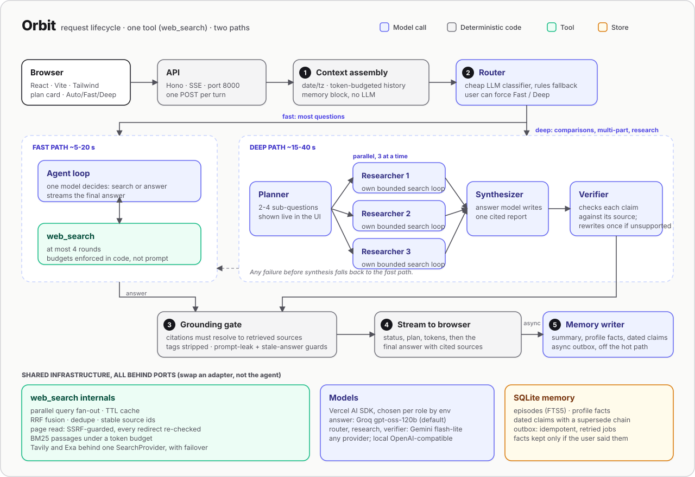

# DESIGN: Orbit, a web-search chat agent

**Thesis:** the model decides, the harness guarantees. Models own the judgment calls: whether to search, what to search, when they know enough. Deterministic code owns what must be exact: dates, memory, citation checks, budgets, retries, fallbacks. Every role is a model prompt over **one tool**, `web_search`.

## How it works

**Fast path** (most questions): one model, a bounded search loop, streamed answer. Budgets are code, not prompt: repeated queries are refused, the last step forbids tools, a soft deadline forces an answer, and a tool-free recovery call turns gathered evidence into an answer if a model misbehaves.

**Deep path** (comparisons, multi-part or research questions): a planner splits the question into up to 4 sub-questions, shown live in the UI; researchers run in parallel (3 at a time, 2 rounds each) on a cheap model; the answer model writes one cited report; a verifier checks each cited claim against the passages the writer saw and rewrites the answer once without unsupported claims. Any failure before synthesis degrades to the fast path, so deep can cost time but never the answer.

**Router:** a cheap model classifies each question with the previous exchange (about 1 s). On timeout or bad output keyword rules decide. Forced modes skip it.

**Retrieval:** parallel queries, TTL cache, reciprocal-rank fusion, optional page reads (SSRF-guarded, every redirect re-checked), BM25 over stemmed passages under a token budget, stable source ids. Page text is untrusted data.

**Memory:** SQLite (FTS5). Dates are SQL keys ("last Tuesday" resolved in the user's timezone), so no embedding fuzz. A profile fact is stored only if its numbers and names appear in what the *user* wrote (a real bug: a chat date was once saved as a birthday). "Has it changed?" is a diff against dated claims.

## Why this shape

- **Speed:** first token waits on one model call plus at most one search round on the fast path. Memory writes run after the response. Prompt prefix is byte-stable for provider caching.
- **Correctness:** most of it comes from retrieval, then grounding; the verifier checks that a citation *supports* the claim, not just that it exists.
- **Scale:** every external dependency (search, models, page reader, store) sits behind a port, so Postgres, Redis or a hosted provider are adapter swaps. Per-provider budgets and bounded fan-out stop our own parallelism from tripping rate limits.
- **Honest limits:** memory and chats are global (no auth or per-user scoping), and there is no rate limiting yet.

## Measured so far (`npm run eval`, LLM judge, live search)

| Run | Result |
|---|---|
| First live run, 26 cases / 10 skills | 20 / 26 |
| After fixing the causes (citation formats, stale answers, injection, date handling) | 26 / 26 (one judge error on a date was overruled by hand) |
| Re-run of 19 cases, judge average | 4.32 / 5 |
| Unit and integration tests (scripted models, no keys) | 175 passing, run in CI |

Latency is poor on Groq's free tier (median about 19 s, p90 about 89 s, mostly rate-limit waits). **Not yet measured:** the 13 newer eval cases, the deep path, router accuracy, verifier false-positive rate (one early run flagged every source), and the model comparison that chooses the default. Reported here rather than claimed. Results are browsable at `/benchmark`.

## Considered and rejected

| Option | Why not |
|---|---|
| LangChain / LangGraph | A five-step pipeline in a few hundred readable lines; a graph framework adds moving parts, not capability |
| Always-deep multi-agent | Slower and costlier on easy questions; deep is opt-in via the router |
| Keyword-only router | Missed paraphrase and other languages; kept only as the fallback |
| Vector DB as primary memory | Dates are exact keys; FTS5 over summaries covers paraphrase |
| Memory as a second tool | Breaks the one-tool rule and adds a round trip |
| Provider-hosted web search | No control over fan-out, page reading, caching, ranking |
| Local model as default | Needs Ollama and a GPU for a reviewer to run; supported as an option |

## With another week

1. Run and publish the numbers above: deep-path cases, a labelled routing set, verifier precision, then choose the default answer model by benchmark.
2. Auth and per-user memory; Postgres and Redis behind the existing interfaces; request rate limits and a token-bucket model gateway.
3. Verifier on the fast path; supersede logic for changed profile facts; a cross-encoder reranker.
4. OpenTelemetry traces from the stage timings already recorded; an eval regression gate in CI.

Stack: TypeScript on Node, Hono + SSE, React + Vite + Tailwind, `better-sqlite3`, Vercel AI SDK, Tavily and Exa. Keys: `.env.example`. Decisions: `docs/DECISIONS.md`.
